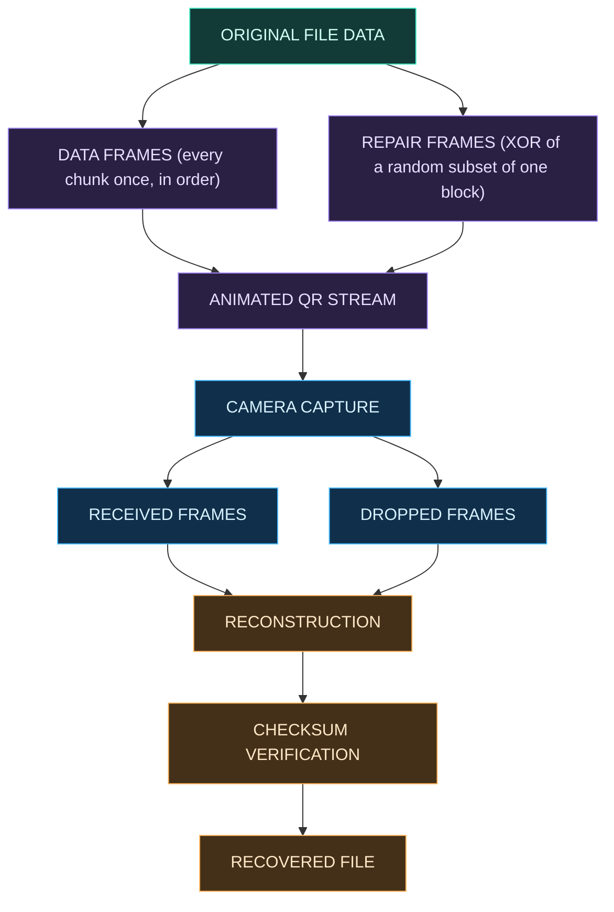

<div align="center">


<a href="https://github.com/enzoceon/offdrop">
  
</a>

<br/>


**[⚡ Quick start](#-quick-start) · [🧠 How it works](#-how-it-works) · [📡 Protocol](#-the-protocol) · [🚀 Performance](#-performance-lab) · [🗂 Project map](#-project-map) · [🛠 Deploy](#-deployment)**

<br/>

```text
 SENDER SCREEN  ━━━━━━━━━━━━━━  ◈  ━━━━━━━━━━━━━━  RECEIVER CAMERA
```

### **Light in. Files out.**

</div>

---

## ✦ What is OFFDROP?

Traditional file transfer needs a network, a cable or somebody else's cloud. **OFFDROP needs a display and a camera.**

The sender turns a file into a stream of animated QR codes. The receiver points its camera at that screen, decodes the frames, repairs anything it missed and rebuilds the original file, byte for byte, verified by checksum.

> No intermediary. No upload. No pairing. No network between the two devices.

| | Cloud sharing | Bluetooth / AirDrop-style | **OFFDROP** |
|:--|:--:|:--:|:--:|
| Needs internet | ✅ | ❌ | **❌** |
| Needs an account | ✅ | sometimes | **❌** |
| Needs pairing / same ecosystem | ❌ | ✅ | **❌** |
| Works across any OS and browser | ✅ | ❌ | **✅** |
| Air-gap friendly (nothing touches a network) | ❌ | ❌ | **✅** |
| File passes through a third-party server | ✅ | ❌ | **❌** |

---

## ✦ Feature highlights

<table>
<tr>
<td width="50%" valign="top">

### 🎞 Animated QR transport
Continuously streams file data through changing QR codes, up to **12 codes on screen at once**, at **up to 30 fps**.

### 📦 Multi-file bundling
Pick many files and OFFDROP zips them into a single transfer automatically.

### 🗜 Automatic compression
Raw-deflate is applied only when it actually shrinks the payload.

### 🐘 Heavy-file streaming
Files up to **4 GB** can be sent; frames are generated on demand and files over 96 MB are streamed from disk, so memory stays flat.

</td>
<td width="50%" valign="top">

### 🩹 Fountain-style repair
After the first pass the sender emits XOR repair frames. A receiver that missed frames needs roughly one repair frame per missing chunk, not a full replay.

### 🔒 Checksum verification
CRC32 over the transmitted bytes; a failed check is discarded and restarted cleanly.

### ⏯ Pause and resume
Tap the QR (or press <kbd>Space</kbd>) to pause. The receiver keeps its progress.

### 🚀 Starts from any frame
Every frame is self-describing. The receiver begins assembling from the very first frame it sees.

</td>
</tr>
</table>

**Also included:** screen wake-lock, haptics and sound feedback, tracked-region camera decoding, camera-capability awareness (HD / 4K), auto-focus assist, installable PWA, light/dark theme, transfer history, and an experimental **Colour ×3** mode that carries three independent codes per tile (R, G, B).

---

## ✦ How it works


| <span style="color:#42E8C5">SENDER</span> | <span style="color:#42B8FF">RECEIVER</span> |
|:--|:--|
| Select one or many files | Press **Start camera** |
| Bundle into a ZIP when needed | Aim at the sender's screen |
| Deflate when it helps | Detect up to 8 codes per camera frame |
| Generate frames just ahead of playback | Rebuild chunks into a pre-allocated buffer |
| Display the animated QR grid | Apply repair frames to fill gaps |
| Emit repair frames forever | Verify the checksum and save |

### Using it

1. **Send** → choose files (or drag and drop) → wait for *Building frames* → tap the QR or press **Play**.
2. **Receive** → open OFFDROP on the other device → **Start camera** → aim at the sender's screen.
3. Hold steady. When the progress ring completes the file is verified and offered for download or preview.

**Tips for speed and reliability:** use the biggest sender screen you have, max out its brightness, keep the receiver parallel to the screen, let the camera focus, and raise *codes per frame* only as far as your camera keeps up with.

---

## ✦ Engineered for recovery

A camera will occasionally miss a frame. OFFDROP is designed around that.



A receiver missing *m* chunks of a block needs only about *m + 2* repair frames for that block, whichever chunks they were. Simulated overhead in the project's tests is roughly **8% at 5% frame loss** and **14% at 30% frame loss** on a 5 MB file.

---

## ✦ The protocol

OFFDROP QR-stream **protocol v3** lives in [`src/lib/qr-protocol.ts`](src/lib/qr-protocol.ts).

- **Self-describing frames.** Every frame begins with the same 24-byte meta block, so there is no special "header frame" to wait for.
- **Base45 in QR alphanumeric mode.** About 97% efficient, versus roughly 75% for base64 in byte mode, and pure text so both the native `BarcodeDetector` and `jsQR` read it safely.
- **Fixed-length frames.** Every QR has the same version and module grid.
- **Blocks of 256 chunks.** Repair frames operate on one block at a time, and the subset is derived from `(id, seed, total)`, so describing it costs 4 bytes.

```text
[magic u8][ver<<4 | flags u8][id u32][ref u32][size u32][chunk u16][crc u32][origSize u32] + payload

magic  0xD1 header · 0xD2 data · 0xD3 repair
ref    data: chunk index · repair: seed · header: 0
flags  bit0 = transmitted bytes are a raw-deflate stream
```

**Playback order:** every data chunk once, in order (so a clean scan finishes in the minimum time), then an endless cycle of repair frames across blocks, with a header frame (name and type) interleaved every 12 frames.

> Both devices must run a compatible protocol version. Frames from older builds are not readable.

---

## ✦ Performance lab

```text
Throughput = Payload per QR  ×  Frames per second  ×  Simultaneous QR codes
```

### Throughput at 15 FPS

| Density | Bytes / QR | 1 code | 4 codes | 6 codes |
|:--|--:|--:|--:|--:|
| 🟢 Reliable | 500 | 7.3 KB/s | 29 KB/s | 44 KB/s |
| 🔵 Balanced | 800 | 11.7 KB/s | 47 KB/s | 70 KB/s |
| 🟣 Dense | 1,100 | 16 KB/s | 64 KB/s | 97 KB/s |
| 🟠 Max | 1,400 | 20 KB/s | 82 KB/s | 123 KB/s |
| 🔴 Ultra | 2,000 | 29 KB/s | 117 KB/s | 176 KB/s |

### Controls

`1×` `2×` `4×` `6×` `8×` `9×` `12×` codes displayed at once (default **4×**) · `15 FPS` default → `30 FPS` maximum · experimental **Colour ×3** mode.

Phone cameras typically capture at 30 fps, so each code stays on screen for about two camera frames at the default 15 fps. Adding codes per frame is what scales throughput.

> [!WARNING]
> Real-world speed depends on camera resolution, focus, lighting, display size, QR density and capture reliability. A 100 MB transfer takes roughly **14 to 20 minutes** in the best realistic conditions. This is not a network-speed transfer, it is a no-network transfer.

---

## ⚡ Quick start

**Requirements:** [Bun](https://bun.sh) or npm · Node.js 22+ for the test suite · a browser with camera access (HTTPS or `localhost`) for receiving.

```bash
git clone https://github.com/enzoceon/offdrop.git
cd offdrop
bun install        # or: npm install
bun run dev
```

| Command | Purpose |
|:--|:--|
| `bun run dev` | Start the development server |
| `bun run test` | Protocol, loss-recovery, compression and receiver-helper tests |
| `bun run typecheck` | TypeScript type checking |
| `bun run lint` | ESLint |
| `bun run build` | Production build |
| `bun run preview` | Preview the production build |

**Trying it on one machine:** open the app in two browser windows or on a laptop and a phone. Send from one, receive on the other. Camera access needs HTTPS or `localhost`.

---

## 🗂 Project map

```text
offdrop/
├─ src/
│  ├─ routes/              TanStack Start routes (index, root, sitemap)
│  ├─ components/
│  │  ├─ Sender.tsx        file picking, QR playback, fullscreen presenter
│  │  ├─ Scanner.tsx       camera, decoding, progress, result preview
│  │  ├─ LaneGrid.tsx      multi-QR grid renderer
│  │  ├─ History.tsx       past transfers
│  │  └─ ...               tabs, theme, sound, install prompt, media viewer
│  └─ lib/
│     ├─ qr-protocol.ts    wire format, CRC32, base45, fountain repair
│     ├─ sender-engine.ts  on-demand frame generation
│     ├─ frame-builder.worker.ts / qr-decode.worker.ts
│     ├─ zip-bundle.ts     multi-file bundling
│     ├─ wake-lock.ts · haptics.ts · feedback.ts · roi.ts
│     └─ ...
├─ scripts/                protocol, compression, zip and receiver tests
├─ public/                 icons, manifest
├─ CHANGES.md              technical history
└─ vercel.json
```

**Stack:** React 19 · TanStack Start and Router · Vite · Nitro · Tailwind CSS 4 · `qrcode` for encoding · native `BarcodeDetector` with `jsQR` fallback · Web Workers · `vite-plugin-pwa`.

---

## 🛠 Deployment

### Vercel

1. Push the repository to GitHub.
2. Open [Vercel](https://vercel.com/) → **Add New → Project**.
3. Import the OFFDROP repository and keep the defaults.
4. Deploy.

`vercel.json` sets the Framework Preset to *Other*; Nitro detects Vercel during the build and emits the Vercel Build Output automatically. Camera access requires HTTPS, which Vercel provides.

### Other platforms

Set `NITRO_PRESET` at build time:

```bash
NITRO_PRESET=cloudflare-module bun run build
NITRO_PRESET=node-server bun run build
```

---

## 🔐 Privacy

No cloud storage. No account creation. No transfer server. No analytics on your files. File data travels only as light between two screens and cameras, and received files stay on the device that received them.

---

## 🧪 Contributing

Issues and pull requests are welcome at [github.com/enzoceon/offdrop](https://github.com/enzoceon/offdrop). Please run `bun run test` and `bun run typecheck` before opening a PR, and see [`CHANGES.md`](CHANGES.md) for the design history.

---

<div align="center">

## WHY SHOULD A FILE NEED THE INTERNET?

**A screen can transmit. A camera can receive. That's enough to move a file.**

<br/>

### Created and maintained by **[enzoceon](https://github.com/enzoceon)**

[](https://github.com/enzoceon)
[](https://github.com/enzoceon/offdrop)

⭐ If OFFDROP is useful to you, a star on the repository helps others find it.

<sub>Acknowledgement: the receiver-side ideas in round 8 (tracked-region decoding, camera-capability awareness, user guidance) were informed by reading the docs of <a href="https://github.com/bashalarmistalt/decimen-optical-transfer">Decimen Optical Transfer</a>. No code was copied; OFFDROP's implementation is independent.</sub>


</div>
