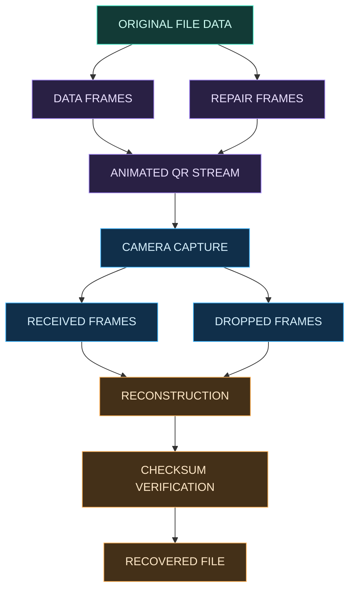

 <div align="center">

# <span style="color:#55E6D0">OFF</span><span style="color:#A78BFA">DROP</span>

### THE INTERNET IS OPTIONAL.

**A file-transfer protocol powered by light.**

Send files from one screen to another using animated QR codes. No servers. No accounts. No internet between devices.

<br/>


<br/>

`SENDER SCREEN` &nbsp; ━━━━━━━━ ◈ ━━━━━━━━ &nbsp; `RECEIVER CAMERA`

**Light in. Files out.**

</div>

---

<div align="center">

## A DIFFERENT KIND OF FILE TRANSFER

</div>

Traditional file transfer relies on networks, cables, or cloud infrastructure.

OFFDROP uses something you already have: a display and a camera.

The sender turns file data into animated QR frames. The receiver scans those frames and reconstructs the original file.

No intermediary. No upload. No network connection between the devices.

---

## 01 / THE OPTICAL LINK

```mermaid
flowchart LR
    A(["FILE"]) --> B["ENCODE"]
    B --> C["QR FRAMES"]
    C --> D["SCREEN"]
    D == "LIGHT" ==> E["CAMERA"]
    E --> F["DECODE"]
    F --> G["VERIFY"]
    G --> H(["FILE"])

    classDef source fill:#102F35,stroke:#42E8C5,color:#C9FFF3,stroke-width:2px
    classDef process fill:#211D42,stroke:#9B8AFF,color:#E5DEFF,stroke-width:2px
    classDef optical fill:#102D48,stroke:#42B8FF,color:#D4F0FF,stroke-width:2px
    classDef result fill:#3B2916,stroke:#FFB45B,color:#FFE5C1,stroke-width:2px

    class A,H source
    class B,C,F,G process
    class D,E optical
```



<div align="center">

| <span style="color:#42E8C5">SENDER</span> | <span style="color:#42B8FF">RECEIVER</span> |
|:---|:---|
| Select files | Open camera |
| Bundle multiple files | Scan QR animation |
| Compress data | Decode frames |
| Generate QR stream | Reconstruct data |
| Display animation | Verify checksum |

</div>

## 02 / ENGINEERED FOR RECOVERY

A camera will occasionally miss a frame. OFFDROP is designed with that reality in mind.

It uses fountain-style repair frames to help reconstruct missing data without requiring the entire transfer to start over.



**The important difference:** the receiver can start from the very first frame it successfully sees. It does not need to wait for a new transfer cycle.

---

## 03 / THE CAPABILITIES

<table>
<tr>
<td width="50%" valign="top">

### <span style="color:#42E8C5">01 — STREAMING</span>

**Animated QR transport**

Continuously streams file data through changing QR codes.

### <span style="color:#42E8C5">02 — BUNDLING</span>

**Multi-file support**

Select multiple files and automatically bundle them into a ZIP archive.

### <span style="color:#42E8C5">03 — COMPRESSION</span>

**Automatic deflation**

Compresses files that benefit from compression.

</td>
<td width="50%" valign="top">

### <span style="color:#A78BFA">04 — RECOVERY</span>

**Fountain-style repair**

Uses additional repair frames to handle dropped data.

### <span style="color:#A78BFA">05 — INTEGRITY</span>

**Checksum verification**

Verifies the reconstructed file.

### <span style="color:#A78BFA">06 — CONTROL</span>

**Pause and resume**

Control the transfer without losing the entire session.

</td>
</tr>
</table>

Additional details:

- Large-file streaming.
- Screen wake-lock support.
- Receiver starts decoding from the first frame it captures.

---

## 04 / PERFORMANCE LAB

<div align="center">

### MORE CODES. MORE PAYLOAD. MORE THROUGHPUT.

</div>

The effective throughput is determined by:

\[
\text{Throughput} =
\text{Payload per QR}
\times
\text{Frames per second}
\times
\text{Simultaneous QR codes}
\]

### Throughput at 15 FPS

| Density | Bytes / QR | 1 code | 4 codes | 6 codes |
|:---|---:|---:|---:|---:|
| <span style="color:#42E8C5">Reliable</span> | 500 | 7.3 KB/s | 29 KB/s | 44 KB/s |
| <span style="color:#42B8FF">Balanced</span> | 800 | 11.7 KB/s | 47 KB/s | 70 KB/s |
| <span style="color:#A78BFA">Dense</span> | 1,100 | 16 KB/s | 64 KB/s | 97 KB/s |
| <span style="color:#FFB45B">Max</span> | 1,400 | 20 KB/s | 82 KB/s | 123 KB/s |
| <span style="color:#FF7B9C">Ultra</span> | 2,000 | 29 KB/s | 117 KB/s | 176 KB/s |

### Transfer controls

<div align="center">

`1×` &nbsp; `2×` &nbsp; `4×` &nbsp; `6×` &nbsp; `8×` &nbsp; `9×` &nbsp; `12×`

<sub>Codes displayed simultaneously · Default: 4×</sub>

<br/>

`15 FPS` DEFAULT &nbsp; → &nbsp; `30 FPS` MAXIMUM

<sub>Experimental Colour ×3 mode also available.</sub>

</div>

> [!WARNING]
> Real-world performance depends on camera resolution, focus, lighting, display size, QR density, and frame capture reliability. A 100 MB transfer takes approximately 14–20 minutes in the best realistic conditions. These are not instant network-like transfers.

---

## 05 / RUN IT YOURSELF

<div align="center">

**OPEN SOURCE. RUN LOCALLY. TRANSFER DIRECTLY.**

</div>

### Requirements

- Bun or npm.
- Node.js 22 or newer for the test suite.
- A browser with camera access for receiving transfers.

### Install

```bash
git clone https://github.com/enzoceon/offdrop.git
cd offdrop
bun install
```

Using npm:

```bash
npm install
```

### Development commands

| Command | Purpose |
|:---|:---|
| `bun run dev` | Start development server |
| `bun run test` | Run protocol, recovery and compression tests |
| `bun run typecheck` | Run type checking |
| `bun run build` | Build production application |

---

## 06 / DEPLOYMENT

### Vercel

1. Push the repository to GitHub.
2. Open [Vercel](https://vercel.com/).
3. Select **Add New → Project**.
4. Import the OFFDROP repository.
5. Keep the default configuration.
6. Deploy.

The `vercel.json` configuration sets the Framework Preset to Other. Nitro detects Vercel during the build and generates the Vercel Build Output automatically.

Camera access requires HTTPS, which Vercel provides.

### Other platforms

Set `NITRO_PRESET` at build time.

```bash
NITRO_PRESET=cloudflare-module
```

Or:

```bash
NITRO_PRESET=node-server
```

---

## 07 / THE PHILOSOPHY

<div align="center">

# WHY SHOULD A FILE NEED THE INTERNET?

<br/>

No cloud storage.

No account creation.

No transfer server.

No network connection between devices.

<br/>

**A screen can transmit. A camera can receive.**

That's enough to move a file.

<br/>

---

### OFFDROP

<span style="color:#42E8C5">OFF</span><span style="color:#A78BFA">DROP</span>

**THE OPTICAL FILE TRANSFER EXPERIMENT.**

[EXPLORE THE REPOSITORY](https://github.com/enzoceon/offdrop)

<sub>Created by <a href="https://github.com/enzoceon">enzoceon</a></sub>

</div>
