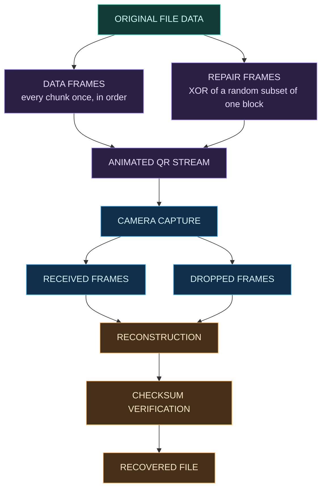

<div align="center">


<br/>

<a href="https://github.com/enzoceon/offdrop"></a>

<br/><br/>


**[Overview](#overview) &nbsp;/&nbsp; [How it works](#how-it-works) &nbsp;/&nbsp; [Self-repair](#self-repair) &nbsp;/&nbsp; [Protocol](#the-protocol) &nbsp;/&nbsp; [Performance](#performance-lab) &nbsp;/&nbsp; [Quick start](#quick-start) &nbsp;/&nbsp; [Deploy](#deployment) &nbsp;/&nbsp; [Support](#support-the-project)**

</div>


## Overview

Every file transfer you have ever done leaned on infrastructure: a router, a cable, a cloud bucket, someone else's server.

**OFFDROP leans on a display and a camera.**

The sender slices a file into frames and plays them as an animated grid of QR codes. The receiver points its camera at the screen, decodes the codes, fills in whatever it missed with repair frames, and rebuilds the original file, byte for byte, checked by CRC32.

> No intermediary. No upload. No pairing. No network between the two devices.

<div align="center">

| | Cloud sharing | Bluetooth / proximity sharing | **OFFDROP** |
|:--|:--:|:--:|:--:|
| Needs internet | Yes | No | **No** |
| Needs an account | Yes | Sometimes | **No** |
| Needs pairing or the same ecosystem | No | Yes | **No** |
| Works across any OS and browser | Yes | No | **Yes** |
| Air-gap friendly | No | No | **Yes** |
| Your file touches a third-party server | Yes | No | **No** |

</div>

### Where it shines

- **Air-gapped machines.** Move a file across a gap with no cable, no USB stick and no radio.
- **Locked-down networks.** Corporate, conference and hotel Wi-Fi that blocks everything.
- **Mixed devices.** Anything with a screen to anything with a camera, any OS, any browser.
- **Privacy.** Nothing is uploaded, logged or stored anywhere but the receiving device.


## How it works




<table>
<tr>
<td width="50%" valign="top">

### Sender

1. Select one or many files, or drag and drop.
2. Multiple files are bundled into a ZIP.
3. Raw deflate is applied only when it shrinks the payload.
4. Frames are generated just ahead of playback, so memory stays flat.
5. The animated QR grid plays. Repair frames never stop.

</td>
<td width="50%" valign="top">

### Receiver

1. Open OFFDROP and press **Start camera**.
2. Aim at the sender's screen.
3. Up to 8 codes are detected per camera frame.
4. Chunks land in a pre-allocated buffer; repair fills the gaps.
5. CRC32 is verified, then the file is ready to save or preview.

</td>
</tr>
</table>

### Using it

1. **Send:** choose files, wait for *Building frames*, then tap the QR or press **Play**. Tap the QR again to pause.
2. **Receive:** on the other device press **Start camera** and aim it at the sender's screen.
3. Hold steady. When the progress ring completes the file is verified and offered for download or preview.

**For the best speed:** use the largest screen you have, turn brightness up, keep the receiver parallel to the screen, let the camera focus, and raise *codes per frame* only as far as your camera keeps up.


## Capabilities

<table>
<tr>
<td width="50%" valign="top">

#### Zero-config Turbo handoff
Direct peer-to-peer data channel (WebRTC) and same-device multi-tab streaming (`BroadcastChannel`). WebRTC uses OFFDROP's signaling endpoint and public STUN for connection setup; file data travels directly between peers, not through a file relay. Speed depends on device and network, and optical transfer remains available when peer connectivity is unavailable.

#### WASM multi-symbol decoding
Powered by C++ SIMD WebAssembly (`zxing-wasm`). Finds up to **12 simultaneous QR codes** in a single pass at **60 FPS** without dropping frames.

#### Animated QR transport
Streams data through changing QR codes, up to **12 codes on screen at once** at up to **30–60 fps**.

#### Multi-file bundling
Pick many files; OFFDROP zips them into a single transfer.

</td>
<td width="50%" valign="top">

#### Automatic compression
Deflate is used only when it actually helps.

#### Fountain-style repair
XOR repair frames let a receiver that missed frames recover without a full replay.

#### Checksum verification
CRC32 over the transmitted bytes. A failed check is discarded and restarted cleanly.

#### Starts from any frame
Every frame is self-describing, so the receiver begins from the first frame it sees.

</td>
</tr>
</table>

**Also built in:** screen wake-lock, haptic and sound feedback, tracked-region camera decoding, camera capability awareness (HD and 4K), auto-focus assist, installable PWA, light and dark themes, transfer history, a transfer report (time, sustained and peak speed), automatic optical fallback for pure air-gaps, and an experimental **Colour x3** mode that carries three independent codes per tile on the R, G and B channels.


## Self-repair

A camera will occasionally miss a frame. OFFDROP is designed around that.





A receiver missing *m* chunks of a block needs only about *m + 2* repair frames for that block, whichever chunks they were. In the project's simulations the overhead is roughly **8% at 5% frame loss** and **14% at 30% frame loss** on a 5 MB file.


## The protocol

OFFDROP's QR-stream protocol (v3) lives in [`src/lib/qr-protocol.ts`](src/lib/qr-protocol.ts).

- **Self-describing frames.** Every frame starts with the same 24-byte meta block, so there is no special header frame to wait for.
- **Base45 in QR alphanumeric mode.** About 97% efficient, versus roughly 75% for base64 in byte mode. Pure text, so both the native `BarcodeDetector` and `jsQR` read it safely.
- **Fixed-length frames.** Every QR has the same version and module grid.
- **Blocks of 256 chunks.** Repair frames work on one block at a time, and the subset is derived from `(id, seed, total)`, so describing it costs 4 bytes.

```text
[magic u8][ver<<4 | flags u8][id u32][ref u32][size u32][chunk u16][crc u32][origSize u32] + payload

magic  0xD1 header   0xD2 data   0xD3 repair
ref    data: chunk index   repair: seed   header: 0
flags  bit0 = transmitted bytes are a raw-deflate stream
```

**Playback order:** every data chunk once, in order (a clean scan finishes in minimum time), then an endless cycle of repair frames across blocks, with a header frame (name and type) interleaved every 12 frames.

> Both devices must run a compatible protocol version. Frames from older builds are not readable.


## Performance lab

```text
Throughput  =  Payload per QR  x  Frames per second  x  Simultaneous QR codes
```

### Transmission modes compared

| Mode | Transport | 100 MB Transfer Time | Peak Throughput | Server / Internet Needed |
|:--|:--|:--:|:--:|:--:|
| **Turbo WebRTC** | Direct P2P Data Channel | Varies by device/network | Varies by device/network | **App signaling + STUN; no file relay** |
| **Turbo Local** | `BroadcastChannel` (Same Device / Multi-Tab) | Varies by device | Varies by device | **No (same device)** |
| **WASM Optical** | 60 FPS C++ SIMD Multi-Code Decoding | **~7 to 10 minutes** | **200 – 350 KB/s** | **No (Air-gap safe)** |
| **Standard Optical** | 15 FPS Monochrome QR Streams | **~14 to 20 minutes** | **80 – 176 KB/s** | **No (Air-gap safe)** |

<br/>

<div align="center">

### Optical throughput at 15–30 FPS (Air-Gapped Mode)

| Density | Bytes / QR | 1 code | 4 codes | 6 codes | 12 codes (WASM) |
|:--|--:|--:|--:|--:|--:|
| Reliable | 500 | 7.3 KB/s | 29 KB/s | 44 KB/s | 88 KB/s |
| Balanced | 800 | 11.7 KB/s | 47 KB/s | 70 KB/s | 140 KB/s |
| Dense | 1,100 | 16 KB/s | 64 KB/s | 97 KB/s | 194 KB/s |
| Max | 1,400 | 20 KB/s | 82 KB/s | 123 KB/s | 246 KB/s |
| Ultra | 2,000 | 29 KB/s | 117 KB/s | 176 KB/s | 352 KB/s |

`1x` `2x` `4x` `6x` `8x` `9x` `12x` codes at once &nbsp;(default **4x**)
&nbsp;/&nbsp; `15 FPS` default, `60 FPS` maximum via WASM
&nbsp;/&nbsp; experimental **Colour x3** mode

</div>

> [!TIP]
> **Dual-Engine Architecture:** When devices can reach OFFDROP's signaling endpoint and WebRTC connectivity succeeds, the optical QR handshake can establish a direct peer channel. Signaling and STUN are used for setup; file bytes do not pass through a relay. If peer connectivity is unavailable or radio is disabled, OFFDROP falls back to pure optical transfer powered by multi-symbol SIMD WebAssembly.


## Quick start

**Requirements:** [Bun](https://bun.sh) or npm, Node.js 22+ for the test suite, and a browser with camera access (HTTPS or `localhost`) for receiving.

```bash
git clone https://github.com/enzoceon/offdrop.git
cd offdrop
bun install        # or: npm install
bun run dev
```

| Command | Purpose |
|:--|:--|
| `bun run dev` | Start the development server |
| `bun run test` | Protocol, loss-recovery, compression and receiver-helper tests |
| `bun run typecheck` | TypeScript type checking |
| `bun run lint` | ESLint |
| `bun run build` | Production build |
| `bun run preview` | Preview the production build |

**Trying it on one machine:** open the app in two windows, or on a laptop and a phone. Send from one, receive on the other.

### Project map

```text
offdrop/
|-- src/
|   |-- routes/              TanStack Start routes
|   |-- components/
|   |   |-- Sender.tsx       file picking, QR playback, fullscreen presenter
|   |   |-- Scanner.tsx      camera, decoding, progress, result preview
|   |   |-- LaneGrid.tsx     multi-QR grid renderer
|   |   `-- ...              tabs, history, theme, sound, install prompt
|   `-- lib/
|       |-- qr-protocol.ts   wire format, CRC32, base45, fountain repair
|       |-- sender-engine.ts on-demand frame generation
|       |-- zip-bundle.ts    multi-file bundling
|       `-- ...              workers, wake-lock, haptics, region tracking
|-- scripts/                 protocol, compression, zip and receiver tests
|-- assets/                  animated README graphics
|-- public/                  icons and manifest
`-- CHANGES.md               technical history
```

**Stack:** React 19, TanStack Start and Router, Vite, Nitro, Tailwind CSS 4, `qrcode` for encoding, native `BarcodeDetector` with a `jsQR` fallback, Web Workers, `vite-plugin-pwa`.


## Deployment

### Vercel

1. Push the repository to GitHub.
2. Open [Vercel](https://vercel.com/), then **Add New**, then **Project**.
3. Import the OFFDROP repository and keep the defaults.
4. Deploy.

`vercel.json` sets the Framework Preset to *Other*; Nitro detects Vercel during the build and emits the Vercel Build Output automatically. Camera access requires HTTPS, which Vercel provides.

### Other platforms

Set `NITRO_PRESET` at build time:

```bash
NITRO_PRESET=cloudflare-module bun run build
NITRO_PRESET=node-server bun run build
```

## Privacy

No cloud storage. No account creation. No transfer server. File data travels only as light between two screens and cameras, and received files stay on the device that received them.

## Contributing

Issues and pull requests are welcome at [github.com/enzoceon/offdrop](https://github.com/enzoceon/offdrop). Please run `bun run test` and `bun run typecheck` before opening a PR. [`CHANGES.md`](CHANGES.md) documents the design history.


## Support the project

OFFDROP is built and maintained by one developer, for free. If it saved you time or solved a problem a network could not, you can help keep it moving.

<div align="center">

[](https://github.com/enzoceon/offdrop)
[](https://github.com/sponsors/enzoceon)

</div>

<!--
Add more donation links here, for example:
[](https://buymeacoffee.com/YOUR_NAME)
[](https://ko-fi.com/YOUR_NAME)
-->

Not able to donate? Starring the repository, sharing it, reporting bugs and sending pull requests help just as much.


<div align="center">

## Why should a file need the internet?

**A screen can transmit. A camera can receive. That is enough to move a file.**

<br/>

### Created and maintained by [enzoceon](https://github.com/enzoceon)

[](https://github.com/enzoceon)
[](https://github.com/enzoceon/offdrop)

<sub>&copy; enzoceon. OFFDROP, the optical file transfer experiment.</sub>

</div>
