<div align="center">



<br/>

<a href="https://github.com/enzoceon/offdrop"></a>

<br/><br/>


**[Overview](#overview) &nbsp;/&nbsp; [Architecture](#architecture--innovations) &nbsp;/&nbsp; [How it Works](#how-it-works) &nbsp;/&nbsp; [Protocol Spec](#the-optical-protocol) &nbsp;/&nbsp; [Performance Lab](#performance-lab) &nbsp;/&nbsp; [Deployment](#deployment) &nbsp;/&nbsp; [Quick Start](#quick-start)**

</div>


## Overview

Every conventional file transfer system leans on shared network infrastructure: a Wi-Fi router, local subnet routing, Bluetooth pairing, a cloud relay, or someone else's server.

**OFFDROP leans on a display and a camera.**

The sender slices any file or multi-file bundle into self-describing binary frames and projects them as a high-frequency, multi-code animated matrix of QR codes. The receiver aims its camera at the transmitting screen, detects and decodes the stream in real time via WebAssembly SIMD, recovers missed packets on the fly with Fountain self-repair codes, and reconstructs the original byte stream verified by hardware-accelerated CRC32.

> **Zero intermediaries. Zero uploads. Zero pairing handshakes. Zero internet required.**

<div align="center">

| Feature | Cloud Storage | AirDrop / Quick Share | WebRTC Direct | **OFFDROP** |
| :--- | :---: | :---: | :---: | :---: |
| **Requires Internet** | Yes | No | Yes (signaling) | **No** |
| **Requires User Accounts** | Yes | Sometimes | No | **No** |
| **Cross-Platform / Any OS** | Yes | No (walled gardens) | Yes | **Yes (Pure Web)** |
| **Hardware Air-Gap Safe** | No | No (radio em fields) | No | **Yes (Pure Optical)** |
| **Zero Network Handshake** | No | No | No | **Yes** |
| **Data Leaves Local Machine** | Yes | No | No | **No** |

</div>

### Where OFFDROP Shines

- **Hardware Air-Gapped Systems:** Bridge physical isolation gaps without inserting USB flash drives, installing untrusted drivers, or activating radio hardware (Wi-Fi, Bluetooth).
- **Restricted Enterprise & Guest Networks:** Circumvent corporate firewalls, conference captive portals, and isolation subnets that block LAN peer discovery and socket connections.
- **Cross-Ecosystem Ad-Hoc Sharing:** Instantly stream gigabytes between iOS, Android, macOS, Windows, Linux, and ChromeOS with no app store downloads or proprietary ecosystem lock-in.
- **Absolute Privacy & Forensics Defense:** Payloads travel strictly as photons through the air. No byte ever touches a socket, ISP log, DNS resolver, or external cache.


## Architecture & Innovations

OFFDROP combines bleeding-edge web platform capabilities, low-level binary packing algorithms, and advanced computer vision to push optical data throughput to its physical limits.

```mermaid
flowchart TD
    subgraph SENDER ["Sender Pipeline"]
        F1["File / Multi-file Input"] --> F2["Fast Stream Hasher (CRC32 >1.2 GB/s)"]
        F2 --> F3["Streaming ZIP Packager (Multi-File)"]
        F3 --> F4["Smart Deflate-Raw Compression"]
        F4 --> F5["Dynamic Rechunker & Frame Packager"]
        F5 --> F6["Parallel Web Worker QR Engine"]
        F6 --> F7["High-FPS Display Matrix (1 - 12 QR Codes)"]
    end

    subgraph OPTICAL_PATH ["Physical Optical Air-Gap"]
        F7 == "Photons / Light" ==> R1["High-Resolution Camera Sensor"]
    end

    subgraph RECEIVER ["Receiver Pipeline"]
        R1 --> R2["Hardware Autofocus & PTZ Dynamic Framing"]
        R2 --> R3["WASM SIMD Multi-Code Decoder (zxing-wasm)"]
        R3 --> R4["Zero-Loss Chunk Adapter (adaptChunkSize)"]
        R4 --> R5["Fountain Decoder (XOR Self-Repair Engine)"]
        R5 --> R6["Direct-to-Buffer Reassembly & CRC32 Validation"]
        R6 --> R7["Verified Payload & Handcrafted Media Viewer"]
    end

    classDef senderStyle fill:#16233B,stroke:#00D6B2,color:#C9FFF3,stroke-width:2px;
    classDef opticalStyle fill:#211D42,stroke:#8B7CFF,color:#E5DEFF,stroke-width:2px;
    classDef receiverStyle fill:#102F35,stroke:#45A9FF,color:#D4F0FF,stroke-width:2px;
    class F1,F2,F3,F4,F5,F6,F7 senderStyle;
    R1 opticalStyle;
    class R2,R3,R4,R5,R6,R7 receiverStyle;
```

### 1. Dynamic Codec & Density Hot-Switching (`adaptChunkSize`)
Never lose progress when tweaking transfer parameters. OFFDROP allows the sender to freely switch between density modes (**Reliable 500 B**, **Balanced 800 B**, **Dense 1100 B**, **Max 1400 B**, **Ultra 2000 B**) or alter the number of concurrent QR lanes (**1, 2, 4, 6, 8, 9, or 12**) mid-transfer.
- **Zero Progress Reset:** The `FountainDecoder` adapts byte ranges dynamically via `adaptChunkSize()`, retaining 100% of received and reconstructed payload data across chunk geometry shifts.
- **Deterministic Session Identification:** Transfer sessions maintain a stable 32-bit identity derived from the underlying file payload hash (`crc ^ (sendSize & 0xffff)`), preventing desynchronization during density hot-swapping.

### 2. High-Performance Stream Processing & Instant Hashing
- **Ultra-Fast Stream Hasher:** Computes CRC32 checksums on multi-hundred-megabyte files at over **1.2 GB/s** utilizing an 8-way unrolled lookup table and Web Worker streaming streams.
- **Accurate Real-Time Math Metrics:** Moving-window throughput calculations ($\Delta \text{bytes} / \Delta t$) provide mathematically precise, identical countdown timers and real-time speed indicators across both transmitting and receiving devices.
- **Flat Memory Footprint:** Frames are produced on-demand just ahead of the screen refresh cycle. Large payloads stream directly from storage without inflating heap memory.

### 3. Hardware Autofocus Lens Steering & Optical Framing
- **Hardware PTZ Integration:** Directly interfaces with camera track hardware capabilities (`focusDistance`, `zoom`, `exposureMode`, and `torch`) to steer optical and digital lenses on supported mobile devices.
- **Dynamic Lock-On Framing:** Real-time geometric calculation tracks the bounding polygon of all visible QR codes, smoothly applying continuous zoom (1.0x to 2.5x) to maintain the optimal 60% viewport fill.
- **Zero-Latency DOM Tracking:** Reticle indicators and HUD markers update directly via direct DOM style mutation, bypassing React render cycles to maintain rock-solid 60 FPS tracking.

### 4. WASM SIMD Multi-Code Engine (`zxing-wasm`)
- Powered by modern C++ barcode engines compiled to WebAssembly with SIMD (Single Instruction, Multiple Data) vector acceleration.
- Concurrently resolves up to 12 distinct QR codes in a single camera frame at up to 60 FPS on modern mobile and desktop browsers.
- Fallback cascade integrates browser-native `BarcodeDetector` and optimized multi-threaded workers to guarantee universal compatibility.

### 5. Handcrafted Liquid Media Viewer Suite
Every received file type is immediately playable and inspectable inside a custom-designed liquid-glass preview interface:
- **`CustomVideoPlayer`:** Precision scrub bar with live frame thumbnails, fluid volume sliders, PiP support, and full keyboard navigation.
- **`CustomAudioPlayer`:** Canvas-rendered interactive waveform visualizer, variable playback speeds (0.5x to 2.0x), and track time scrubbing.
- **`CustomFilePreview`:** Syntax-highlighted code inspector with line numbering, rich Markdown renderer, multi-page PDF reader, and nested ZIP archive browser.

### 6. Liquid Glassmorphism HUD & Ergonomics
- **Hover Auto-Timeout:** Transport overlay controls over the QR stream fade out smoothly after 1 second of cursor inactivity to ensure optical clarity for camera sensors.
- **Balanced 4×2 Grid Geometry:** 8-code displays render cleanly as 4 columns by 2 rows on desktop viewports, avoiding awkward asymmetrical cut-offs.
- **Destructive Action Safety:** Liquid-glass confirmation dialogs with frosted backdrop filters protect against accidental file dismissal or cancelled transfers.


## How it Works

### Optical Stream Flow

```
[ Sender Device ]                                      [ Receiver Device ]
       │                                                        │
       ├─► Slices file into N chunks (500B - 2000B)            │
       ├─► Generates base45 self-describing binary frames       │
       ├─► Renders animated QR matrix (15-30 fps)               │
       │                                                        │
       │ ~ ~ ~ Photons / Light (Air Gap) ~ ~ ~ ~ ~ ~ ~ ~ ~ ~ ~ ►│
       │                                                        ├─► Camera captures 1080p/4K @ 60fps
       │                                                        ├─► WASM SIMD decodes multi-QR grid
       │                                                        ├─► Reads 24-byte frame header
       ├─► Emits Fountain XOR repair packets continuous loop   │
       │                                                        ├─► Self-repair engine solves drops
       │                                                        ├─► Validates full-file CRC32
       ▼                                                        ▼
[ Transmission Complete ]                              [ Verified File Ready ]
```

### Self-Repair Engine (Fountain Codes)

In an optical transfer, dropped frames are inevitable: camera auto-exposure hunting, rolling shutter artifacts, screen reflections, or physical hand tremors can cause frames to be missed.

Conventional protocols force the sender to start over or wait for the exact missed frame index to cycle back. **OFFDROP uses Fountain Self-Repair Codes:**
1. After delivering the primary chunks, the sender broadcasts systematic repair packets.
2. Each repair frame contains an XOR linear combination of pseudo-randomly selected source chunks within a 256-chunk block:
   $$\text{Repair} = C_{i} \oplus C_{j} \oplus C_{k} \dots$$
3. As long as the receiver collects any $K$ unique combinations for $K$ missing chunks, Gaussian elimination recovers the missing data instantly.
4. Overhead is exceptionally low: typically only $\approx 8\%$ additional frames at $5\%$ packet loss, eliminating sender-receiver backchannel requirements.


## The Optical Protocol

Every QR code transmitted in OFFDROP v3 carries a self-describing binary header encoded in Base45, mapped directly into QR Alphanumeric Mode for maximum module density.

### Frame Binary Layout (24-Byte Header)

```
 0                   1                   2                   3
 0 1 2 3 4 5 6 7 8 9 0 1 2 3 4 5 6 7 8 9 0 1 2 3 4 5 6 7 8 9 0 1
+-+-+-+-+-+-+-+-+-+-+-+-+-+-+-+-+-+-+-+-+-+-+-+-+-+-+-+-+-+-+-+-+
|          Magic 'OD'           |  Version (3)  |   Frame Type  |
+-+-+-+-+-+-+-+-+-+-+-+-+-+-+-+-+-+-+-+-+-+-+-+-+-+-+-+-+-+-+-+-+
|                      Transfer ID (32-bit)                     |
+-+-+-+-+-+-+-+-+-+-+-+-+-+-+-+-+-+-+-+-+-+-+-+-+-+-+-+-+-+-+-+-+
|      Chunk Size (16-bit)      |      Total Chunks (16-bit)    |
+-+-+-+-+-+-+-+-+-+-+-+-+-+-+-+-+-+-+-+-+-+-+-+-+-+-+-+-+-+-+-+-+
|      Chunk Index / Seed       |             Flags             |
+-+-+-+-+-+-+-+-+-+-+-+-+-+-+-+-+-+-+-+-+-+-+-+-+-+-+-+-+-+-+-+-+
|                      Payload CRC32 (32-bit)                   |
+-+-+-+-+-+-+-+-+-+-+-+-+-+-+-+-+-+-+-+-+-+-+-+-+-+-+-+-+-+-+-+-+
|                      Original File Size (Bytes)               |
+-+-+-+-+-+-+-+-+-+-+-+-+-+-+-+-+-+-+-+-+-+-+-+-+-+-+-+-+-+-+-+-+
|                                                               |
|                   Frame Payload (Data or XOR)                 |
|                                                               |
+-+-+-+-+-+-+-+-+-+-+-+-+-+-+-+-+-+-+-+-+-+-+-+-+-+-+-+-+-+-+-+-+
```

| Field | Size | Description |
| :--- | :--- | :--- |
| **Magic** | 2 bytes | Protocol identifier ASCII `'OD'` (`0x4F44`). |
| **Version** | 1 byte | Protocol version (`0x03`). |
| **Type** | 1 byte | Frame type (`0x00`: Data, `0x01`: Fountain Repair, `0x02`: Metadata). |
| **Transfer ID** | 4 bytes | 32-bit unique transfer hash (`crc ^ (size & 0xffff)`). |
| **Chunk Size** | 2 bytes | Byte payload length per chunk. |
| **Total Chunks** | 2 bytes | Total count of systematic chunks in the transfer. |
| **Index / Seed** | 2 bytes | Systematic chunk index or PRNG seed for Fountain linear combinations. |
| **Flags** | 2 bytes | Bitmask for compression (`0x01`: Deflate-Raw), bundling, encryption. |
| **Payload CRC32** | 4 bytes | IEEE 802.3 CRC32 checksum of the complete uncompressed file. |
| **File Size** | 4 bytes | Total size in bytes of the uncompressed transfer. |
| **Payload** | Variable | Raw binary chunk data padded to equal length for uniform QR sizing. |


## Performance Lab

Measured real-world optical throughput across modern displays and smartphone cameras:

### Density Modes

| Preset | Payload / QR | QR Version | EC Level | Minimum Camera Distance |
| :--- | :---: | :---: | :---: | :---: |
| **Reliable** | 500 B | v17 (85×85) | M (15%) | 0.8m – 1.5m (Any phone camera) |
| **Balanced** | 800 B | v23 (109×109) | L (7%) | 0.4m – 0.9m (Standard webcams) |
| **Dense** | 1,100 B | v28 (129×129) | L (7%) | 0.3m – 0.6m (HD / 1080p cameras) |
| **Max** | 1,400 B | v29 (133×133) | L (7%) | 0.2m – 0.4m (High PPI screens) |
| **Ultra** | 2,000 B | v34 (153×153) | L (7%) | 0.2m (4K sensors + OLED screens) |

### Throughput Scaling by Code Count

| Codes at Once | Frame Rate | Theoretical Bandwidth | Typical Sustained Air-Gap Rate |
| :---: | :---: | :---: | :---: |
| **1 QR** | 15 fps | 12 KB/s – 30 KB/s | **18 KB/s** |
| **2 QR** | 20 fps | 32 KB/s – 80 KB/s | **55 KB/s** |
| **4 QR** | 20 fps | 64 KB/s – 160 KB/s | **125 KB/s** |
| **8 QR** | 25 fps | 160 KB/s – 400 KB/s | **310 KB/s** |
| **12 QR** | 30 fps | 288 KB/s – 720 KB/s | **580 KB/s** |

*(When peer networks permit, OFFDROP automatically negotiates Turbo P2P WebRTC data channels via optical QR signaling, reaching full wire speeds of **50+ MB/s** without external relays.)*


## Quick Start

### Prerequisites
- [Node.js](https://nodejs.org/) (v18.0.0 or later) or [Bun](https://bun.sh/)
- Modern browser with Camera (`getUserMedia`) support

```bash
# Clone the repository
git clone https://github.com/enzoceon/offdrop.git
cd offdrop

# Install dependencies
npm install

# Start development server
npm run dev
```

Open [http://localhost:3000](http://localhost:3000) in your browser.

### Test Suites

```bash
# Run unit and integration tests
npm test

# Run pure-protocol round-trip test with loss simulation
npm run test:protocol

# Run strict TypeScript typechecking
npm run typecheck

# Build for production
npm run build
```


## Deployment

OFFDROP builds into a standard, lightweight universal output powered by **TanStack Start** and **Nitro**. It can be hosted on any static edge, Docker container, Node.js server, or self-hosted VPS.

> [!IMPORTANT]
> **HTTPS Required:** Browser security policies mandate a secure context (`https://` or `http://localhost`) for camera access (`navigator.mediaDevices.getUserMedia`) and WebRTC data channels. Always configure TLS/SSL on public hostnames.

### Option 1: Standalone Node.js Server

The default build produces a self-contained Node.js server in `.output/server/`:

```bash
# Build the production application
npm run build

# Start the standalone server
node .output/server/index.mjs
```
The server listens on `http://localhost:3000` by default (configurable via `PORT` and `HOST` environment variables).

### Option 2: Docker Container

Create a lightweight, reproducible container for bare-metal or cloud instances:

```dockerfile
# Multi-stage Docker build
FROM node:20-alpine AS builder
WORKDIR /app
COPY package*.json ./
RUN npm ci
COPY . .
RUN npm run build

FROM node:20-alpine AS runner
WORKDIR /app
ENV NODE_ENV=production
ENV PORT=3000
COPY --from=builder /app/.output ./.output
EXPOSE 3000
CMD ["node", ".output/server/index.mjs"]
```

Build and run:
```bash
docker build -t offdrop .
docker run -p 3000:3000 --restart always offdrop
```

### Option 3: Cloudflare Workers / Pages

Compile with Nitro's Cloudflare preset:

```bash
NITRO_PRESET=cloudflare-module npm run build
```

Deploy the generated `.output` bundle using `wrangler`:
```bash
npx wrangler deploy
```

### Option 4: Custom Domain & Reverse Proxy (Nginx / Caddy)

Place OFFDROP behind Caddy or Nginx for automated Let's Encrypt TLS:

**Caddyfile Example:**
```caddy
your-domain.com {
    reverse_proxy localhost:3000
    encode zstd gzip
}
```

**Nginx Example:**
```nginx
server {
    listen 443 ssl http2;
    server_name your-domain.com;

    ssl_certificate /etc/letsencrypt/live/your-domain.com/fullchain.pem;
    ssl_certificate_key /etc/letsencrypt/live/your-domain.com/privkey.pem;

    location / {
        proxy_pass http://127.0.0.1:3000;
        proxy_http_version 1.1;
        proxy_set_header Upgrade $http_upgrade;
        proxy_set_header Connection "upgrade";
        proxy_set_header Host $host;
        proxy_set_header X-Forwarded-For $proxy_add_x_forwarded_for;
        proxy_set_header X-Forwarded-Proto https;
    }
}
```


## Repository Structure

```
offdrop/
|-- src/
|   |-- components/          React UI components (Sender, Scanner, History, MediaViewer)
|   |-- lib/
|   |   |-- qr-protocol.ts   Protocol v3 binary packer, header builder, base45 encoder
|   |   |-- fountain.ts      Fountain XOR linear repair decoder & chunk adapter
|   |   |-- sender-engine.ts On-demand frame streaming, multi-density rechunker
|   |   |-- zxing-decoder.ts WASM SIMD C++ multi-barcode detection engine
|   |   |-- custom-media/    Handcrafted video, audio, code, pdf & archive viewers
|   |   |-- rate-meter.ts    Windowed real-time ETA & throughput math engine
|   |   |-- roi.ts           Region-of-interest viewport crop & edge tracker
|   |   |-- haptics.ts       Semantic tactile feedback engine (Android & iOS)
|   |   |-- audio.ts         Web Audio synth with pentatonic tonal scale
|   |   `-- webrtc.ts        Zero-config Turbo P2P WebRTC data channel
|   |-- routes/              TanStack Start file-system routes
|   `-- styles.css           Tailwind CSS 4 animations & liquid glassmorphism
|-- scripts/                 Protocol verification & compression test harnesses
`-- CHANGES.md               Complete technical history from v1.0.0 to v9.0.0
```


## Privacy & Security Guarantees

- **100% Client-Side Processing:** No file contents, file names, or telemetry data are ever transmitted to an external server.
- **Ephemerality:** All transfers occur in volatile browser memory or localized origin storage (`IndexedDB`) on the receiving device.
- **Physical Boundary Security:** Because data moves purely as optical light, physical boundaries (tinted glass, visual enclosures, RF-shielded SCIFs) provide natural eavesdropping immunity.


## Support the Project

OFFDROP is open source software built for universal access and digital sovereignty. If this tool saved you time or bridged an impossible air-gap, consider supporting continued development.

<div align="center">

[](https://github.com/enzoceon/offdrop)
[](https://github.com/sponsors/enzoceon)

</div>


<div align="center">

## Why should a file need the internet?

**A screen can transmit. A camera can receive. That is enough to move a file.**

<br/>

### Created and maintained by [enzoceon](https://github.com/enzoceon)

[](https://github.com/enzoceon)
[](https://github.com/enzoceon/offdrop)

<sub>&copy; enzoceon. OFFDROP — The Optical File Transfer Engine.</sub>

</div>
