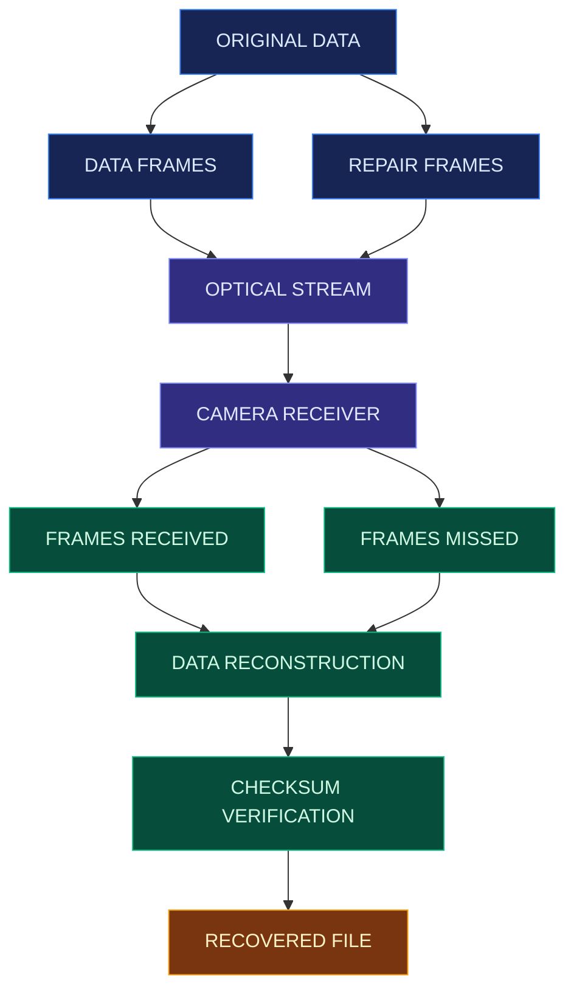

 <div align="center">

# OFFDROP

### FILE TRANSFER. WITHOUT THE INTERNET.

**Your screen is the sender. Their camera is the receiver.**

No servers. No accounts. No internet connection between devices. Just animated QR codes turning your display into a file-transfer channel.

<br />


<br />

**Send anything. Across a screen. Without a network.**

</div>

---

## The idea

Most file-transfer tools need something in the middle: a server, a cloud account, a local network, or an internet connection.

OFFDROP doesn't.

It converts file data into a continuous stream of animated QR codes. One device displays the stream. Another device reads it through its camera and reconstructs the original file.

No infrastructure. No account creation. No file upload to somebody else's server.

Just light carrying data.

## How it works


### Two devices. One optical connection.

<table>
<tr>
<td width="50%" valign="top">

**01 — SENDER**

Select one file or multiple files. Multiple files are automatically bundled into a ZIP archive.

OFFDROP encodes the data into QR frames and plays them as an animation on the screen.

</td>
<td width="50%" valign="top">

**02 — RECEIVER**

Open the receiver and point the camera at the sender's screen.

The receiver reads frames, reconstructs the data, repairs dropped frames where possible, and verifies the result.

</td>
</tr>
</table>

---

## Built for transfers that don't fall apart

| Capability | What it does |
|:--|:--|
| Animated QR streaming | Transfers data through continuously changing QR frames |
| Multi-file transfer | Bundles multiple selected files into a ZIP archive |
| Checksum verification | Verifies the reconstructed file's integrity |
| Fountain-style recovery | Uses repair frames to recover missing data without restarting the entire transfer |
| Automatic compression | Deflates compressible files automatically |
| Large-file streaming | Streams data instead of requiring the entire transfer to be handled as one QR code |
| Pause and resume | Gives you control over an ongoing transfer |
| Wake lock | Helps prevent the sender's screen from sleeping during transfers |
| Immediate reception | Receiver can begin with the very first frame it successfully reads |

## The interesting part: recovery

QR streaming isn't a perfect channel.

A camera can miss frames. Screens can refresh at inconvenient moments. Lighting, focus, distance, and display quality can affect reception.

OFFDROP accounts for dropped frames with fountain-style repair frames.

Instead of requiring the receiver to replay the entire transfer whenever a frame is missed, repair frames provide additional data that helps reconstruct the original content.



The receiver doesn't need to catch every single frame. It needs enough usable information to reconstruct the data.

---

## Performance

### Throughput depends on the camera, the screen, and QR density.

The effective throughput is determined by:

**Payload per QR × frames per second × number of simultaneous QR codes.**

The following figures represent calculated throughput at 15 FPS.

| Density | Bytes / QR | 1 code | 4 codes | 6 codes |
|:--|--:|--:|--:|--:|
| Reliable | 500 | 7.3 KB/s | 29 KB/s | 44 KB/s |
| Balanced | 800 | 11.7 KB/s | 47 KB/s | 70 KB/s |
| Dense | 1,100 | 16 KB/s | 64 KB/s | 97 KB/s |
| Max | 1,400 | 20 KB/s | 82 KB/s | 123 KB/s |
| Ultra | 2,000 | 29 KB/s | 117 KB/s | 176 KB/s |

### Real-world speed matters more than theoretical speed.

Phone cameras commonly capture at 30 FPS. OFFDROP's speed slider defaults to 15 FPS and stops at 30 FPS, allowing each QR code to remain visible for approximately two camera frames at the default setting.

The bigger throughput multiplier is the number of QR codes displayed simultaneously.

**Available configurations:**

`1×` `2×` `4×` `6×` `8×` `9×` `12×`

Default: `4×`

There is also an experimental **Colour ×3** mode.

> [!IMPORTANT]
> A 100 MB transfer can take approximately 14–20 minutes in the best realistic conditions. Actual speed depends heavily on screen size, camera resolution, focus, lighting, QR density, and frame capture reliability. OFFDROP prioritises a working transfer over unrealistic speed claims.

---

## Transfer architecture

<div align="center">

| SENDER | OPTICAL CHANNEL | RECEIVER |
|:---:|:---:|:---:|
| File selection | Animated QR codes | Camera scanning |
| ZIP bundling | Screen display | Frame decoding |
| Compression | Visible light | Data reconstruction |
| Data encoding | No network required | Integrity verification |

</div>

The transfer happens directly between the two devices through their display and camera. There is no intermediary file-hosting service involved.

---

## Run it locally

### Requirements

- [Bun](https://bun.sh/) or Node.js with npm
- Node.js 22 or newer for the test suite
- A browser with camera access for receiving transfers

### Installation

```bash
git clone https://github.com/enzoceon/offdrop.git

cd offdrop

bun install
```

Using npm instead:

```bash
npm install
```

### Development

```bash
bun run dev
```

### Tests

```bash
bun run test
```

The test suite covers protocol, loss-recovery, and compression tests.

### Type checking

```bash
bun run typecheck
```

### Production build

```bash
bun run build
```

---

## Deploy to Vercel

OFFDROP can be deployed through GitHub and Vercel.

1. Push the repository to GitHub.
2. Open [Vercel](https://vercel.com/).
3. Select **Add New → Project**.
4. Import the OFFDROP repository.
5. Keep the default configuration.
6. Deploy.

The repository's `vercel.json` configures the project for the appropriate deployment flow. Nitro detects Vercel at build time and generates the Vercel Build Output automatically.

Camera access requires HTTPS, which Vercel provides.

### Deploy somewhere else

Set `NITRO_PRESET` during the build process to target another deployment platform.

For example:

```bash
NITRO_PRESET=cloudflare-module
```

Or:

```bash
NITRO_PRESET=node-server
```

---

## Design philosophy

OFFDROP is built around a simple idea:

**A file should not need the internet to move from one device to another.**

The project explores an unconventional use of hardware that already exists on almost every modern device: a screen and a camera.

No special transfer hardware. No dedicated cables. No accounts. No cloud storage dependency.

Just an optical data channel.

---

<div align="center">

### NO CLOUD. NO CABLES. NO MIDDLEMAN.

**JUST DROP IT.**

<br />

[GitHub Repository](https://github.com/enzoceon/offdrop)

<sub>Built by <a href="https://github.com/enzoceon">enzoceon</a></sub>

</div>
